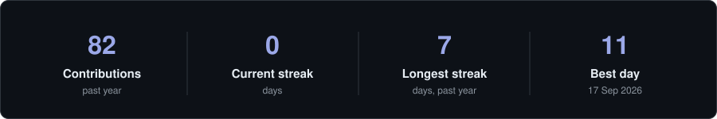
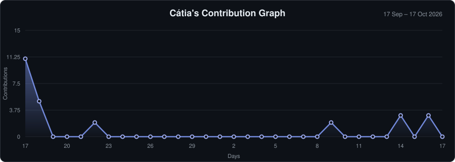

  

### About me

- 💼 &nbsp;**Data Engineer**
- 🎓 &nbsp;Bachelor's degree (Licenciatura) in **Computer Science**
- ☁️ &nbsp;I work mostly with **Python** and **AWS**
- 🔒 &nbsp;Most of my work is private (company and personal projects), so the activity below includes private contributions

### Tech stack

<table>
  <tr>
    <td align="right"><b>Languages</b></td>
    <td>
      &nbsp;
    </td>
  </tr>
  <tr>
    <td align="right"><b>Cloud</b></td>
    <td>
      
    </td>
  </tr>
  <tr>
    <td align="right"><b>Databases</b></td>
    <td>
      
    </td>
  </tr>
  <tr>
    <td align="right"><b>Tools</b></td>
    <td>
      &nbsp;
      &nbsp;
      &nbsp;
      
    </td>
  </tr>
</table>

### Activity

  

  

<!-- stats.svg and activity.svg are regenerated daily by .github/workflows/update-stats.yml -->
<!-- Technology icons: https://marwin1991.github.io/profile-technology-icons/ -->
